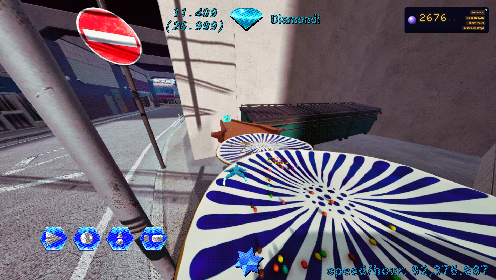
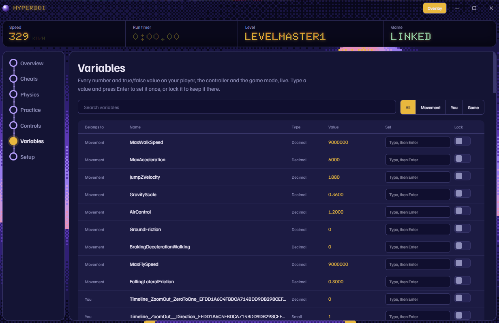
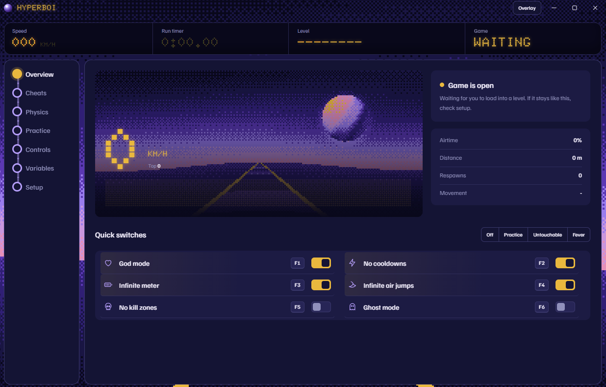
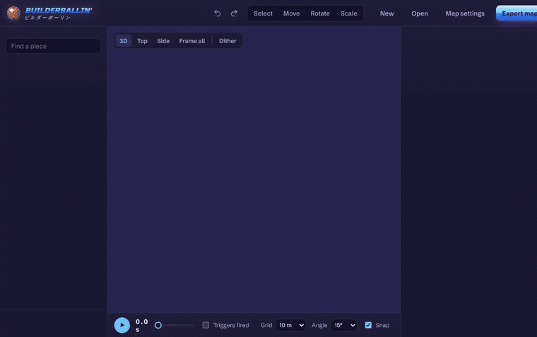
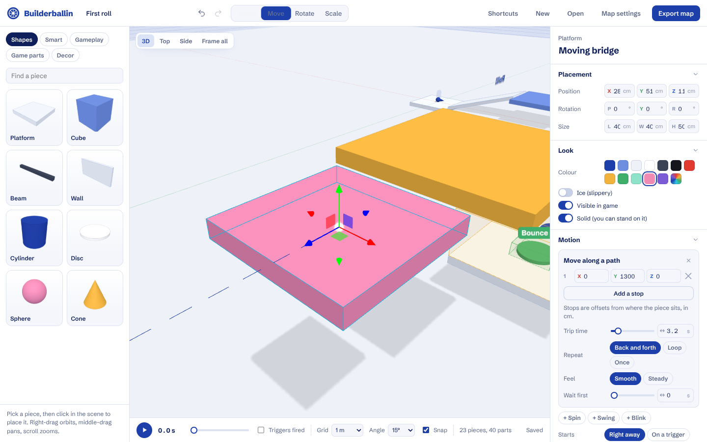
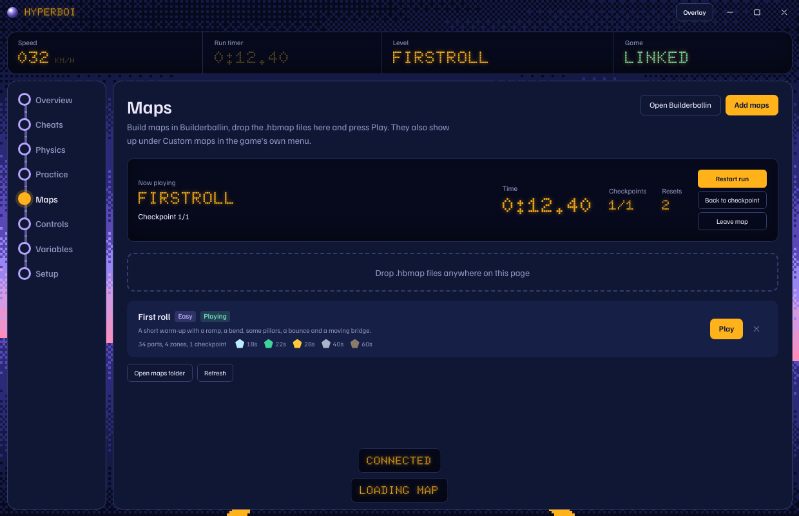

<p align="center">
  
</p>

# Hyperboi

A trainer for [Hyperballin](https://itch.io/search?q=hyperballin), the free marble parkour game on itch.io. Hyperboi hooks into the game while it runs and gives you god mode, no cooldowns, infinite air jumps, physics sliders, warp spots, a run timer and a live view of the game's own variables, so you can practice the hard parts of a course over and over.

It also comes with **Builderballin**, a map editor that runs in your browser, so you can build your own courses and play them in the real game.

Hyperballin is single player. Hyperboi only touches your own game on your own PC.

<p align="center">
  
</p>

## What it does

### Cheats

| Cheat | What happens |
| --- | --- |
| God mode | Health stays full and you can't take damage |
| No cooldowns | Dashes, surfs and the rest are ready again right away |
| Infinite meter | Stamina, energy and boost style bars stay full |
| Infinite air jumps | Jump as many times as you want in the air |
| No kill zones | Kill zones stop resetting you, so you can fall anywhere |
| Ghost mode | Turns off collision so you fly through walls and floors |
| Freeze in place | Holds you where you are, even mid-air |
| Fever cam | Field of view swells in and out on its own |
| Spin cycle | The camera keeps turning and you have to deal with it |

When a cheat is on, it lists the game variables it's holding, so you can see it actually working.

There are also four presets: **Off**, **Practice**, **Untouchable** and **Fever**.

### Physics

Sliders for your speed, world speed (slow motion), jump height, gravity (it goes negative, so you can fall up), air control, size and field of view. There are buttons to launch straight up, boost forward and stop dead. Double-click any slider to reset it.

"Your speed" speeds up your character itself, so moves and abilities speed up with you instead of breaking.

### Practice

- **Warp spots.** 5 per level. Save where you're standing, name it, warp back whenever. They're saved per level and stay after you restart.
- **Run timer.** Turn on auto-arm and warping to a spot arms the timer. It starts the moment you move, and you stop it with a hotkey.
- **Gem ranks.** Every run gets ranked against your best the same way the game does it: diamond, emerald, gold, steel, rock and coal.
- **Route map.** A top-down trail of where you've been, coloured by speed, with your best run drawn as a dashed line to race against.

### Controls

Hyperboi reads the keybinds straight out of the game while it runs, so you see the real controls instead of a guess. It also lists every move in the game files (dash, air dash, marble dash, floor surf, fast fall, helicopter, wall cling, zen jump and so on) with the key for each one when the game exposes it.

### Variables



Every number and true/false value on your player, the controller and the game mode, live. Type a value and press Enter to set it once, or lock it so it stays there. This is the place to go if a cheat doesn't catch something, since you can find the exact variable and lock it yourself.

### Overlay

A small always-on-top panel with your speed, your timer and which cheats are on. It ignores the mouse, so it never gets in the way of the game.

### Overview



The departure board up top always shows your speed, run timer, the level you're on and whether the game is connected. The overview page adds a speed graph, airtime, distance, respawns and quick switches for the main cheats.

## Builderballin

<p align="center">
  
</p>

**[Open Builderballin](https://drapids.github.io/Hyperboi/builderballin/)**

A 3D map editor for Hyperballin. Nothing to install, it runs in the browser and saves as you go.

Making a basic map takes a minute: pick a piece, click to place it, drag to paint a row of them. Underneath that there's a lot more to dig into.

- **Shapes:** platforms, cubes, beams, walls, cylinders, discs, spheres and cones, at any size and in any colour.
- **Smart pieces:** ramps, stairs, curves that bank and climb, loops and corkscrews, tubes, half pipes, pillar rows, zigzags and hoops. Change a number and the whole thing rebuilds.
- **Gameplay:** spawn, finish, checkpoints, kill zones, bounce pads, boost pads, speed zones, gravity zones, wind, slow motion, teleporters, triggers and message zones.
- **Game parts:** real pieces from Hyperballin, like the rounded track, half tunnels, the spinning striped plate, boost and bounce pillars, hook points, the marble and the gorilla.
- **Motion:** anything can move along a path, spin, swing or blink on and off. It can start right away or wait for a trigger, so you can build doors, crushers and collapsing floors.
- **Editing:** move, rotate and scale gizmos, snapping, box select, groups, copy and paste, an array tool for making rows and spirals of copies, mirroring, and undo.
- **Preview:** a time scrubber plays every moving part so you can check timing before you test in game.
- **Map settings:** name, author, difficulty, gem times, and rules for gravity, run speed, jump height, fall limit, time limit and required checkpoints.
- **Files:** maps save as `.hbmap` files. Drag one onto the page to open it.



### Playing your maps



1. Press **Export map** in Builderballin to download the `.hbmap` file.
2. In Hyperboi, open **Maps** and drop the file in.
3. Load into any level in the game and press **Play**. The map is built up in the sky above the level and you're dropped at its spawn.

The Maps page shows your run time, checkpoints and resets live. Each map remembers your best time and the gem you earned. Leave the map and you're put back where you were.

The mod also tries to add **Custom maps** to the game's own main menu, next to Options. Pick a map there and the game starts with it loaded.

Under the hood, the map is built from Unreal's own basic shapes plus the game's real meshes. Moving parts are updated every frame, and zones are checked against your position as you play.

## Hotkeys

These work while you're in the game. You can change any of them on the Controls page, or turn them all off.

| Key | Does |
| --- | --- |
| F1 | God mode |
| F2 | No cooldowns |
| F3 | Infinite meter |
| F4 | Infinite air jumps |
| F5 | No kill zones |
| F6 | Ghost mode |
| F7 | Slow motion |
| F8 | Save spot 1 |
| F9 | Warp to spot 1 |
| F10 | Boost forward |
| Shift + F1 | Freeze in place |
| Shift + F2 | Fever cam |
| Shift + F3 | Start or stop the timer |
| Shift + F4 | Show or hide the overlay |

## Getting it running

You need Windows, the game, and [Node.js](https://nodejs.org/en/download) (the LTS version).

1. Download or clone this repo.
2. Double-click **Start Hyperboi.bat**. The first time, it installs what it needs, which takes about a minute.
3. In Hyperboi, open **Setup**:
   1. **Find the game.** Press Find automatically, or Browse and pick `project_garden.exe` from your Hyperballin folder.
   2. **Install the hook.** Close the game first. This downloads UE4SS and adds the Hyperboi mod to the game folder.
   3. **Play.** Launch the game and load into a level. The board says LINKED when it's working.

If you'd rather have a single exe, run **Build Hyperboi exe.bat**. It puts `Hyperboi.exe` in the `dist` folder, and that exe runs from anywhere.

To put the game back to normal, press **Turn hook off** in Setup. Nothing gets deleted, so you can turn it back on whenever.

## How it works

Hyperballin is an Unreal Engine 5.8 game. Hyperboi has two halves:

- **The app.** An Electron window built with Tailwind. It's what you click on, and it handles the hotkeys.
- **The mod** (`hook/Hyperboi/Scripts/main.lua`). A Lua script that runs inside the game through [UE4SS](https://github.com/UE4SS-RE/RE-UE4SS). It finds your player, the movement component, the camera and the world, and changes them through Unreal's own reflection system.

The two talk through two small text files in the mod's `bridge` folder. The app writes what you want turned on to `cmd.txt`. The mod reads it about 20 times a second, applies it, and writes what's happening in the game back to `state.txt`. That includes your position, speed, level, variables and keybinds.

Since the game's code isn't public, the cheats find the right variables by their names: health, cooldown, stamina, "can dash" and so on. That's why each cheat shows what it grabbed, and why the Variables page exists for anything it misses.

## Project layout

```
main.js                  Electron main process: game detection, hook install, file bridge, hotkeys
preload.js               What the window is allowed to call
src/index.html           The app window
src/app.js               All the UI logic
src/input.css            Tailwind source and the custom styles
src/tw.css               Compiled CSS (built from input.css)
src/mini.html, mini.js   The overlay
hook/Hyperboi/           The UE4SS mod that goes into the game
  Scripts/main.lua       Cheats, physics, warps and the bridge
  Scripts/maps.lua       Builds custom maps in game and runs their zones and motion
  Scripts/menu.lua       Adds Custom maps to the game's menu
  Scripts/json.lua       Reads map files
builderballin/           The map editor (plain static site, three.js)
scripts/build-css.mjs    Rebuilds tw.css
assets/icon.png          App icon
```

After changing classes in the HTML or JS, run `npm run css` to rebuild `tw.css`.

Builderballin has no build step. To run it locally, serve the `builderballin` folder with any static server, for example `npx serve builderballin`.

## If it's not connecting

- **Load into an actual level.** The main menu doesn't count.
- **UE4SS might not support Unreal 5.8 yet.** If it doesn't, the game opens like nothing happened. Reinstall the hook once a newer UE4SS build is out.
- **Check Windows Defender.** It sometimes quarantines `dwmapi.dll` (that's UE4SS's loader). Look in Protection history.
- **Close the game before installing.** The game locks its files while it's running.
- **A map won't load?** Check `ue4ss/Mods/Hyperboi/bridge/maps_log.txt` in the game folder. It lists any pieces the game couldn't find.

## Credits

- [Hyperballin](https://itch.io/search?q=hyperballin), the game this is for. Hyperboi isn't made by or connected to its developer.
- [UE4SS](https://github.com/UE4SS-RE/RE-UE4SS), which makes the in-game part possible.
- [three.js](https://threejs.org) for Builderballin's 3D view.
- [Doto](https://fonts.google.com/specimen/Doto), [Familjen Grotesk](https://fonts.google.com/specimen/Familjen+Grotesk) and [Schibsted Grotesk](https://fonts.google.com/specimen/Schibsted+Grotesk) from Google Fonts.

## License

MIT
